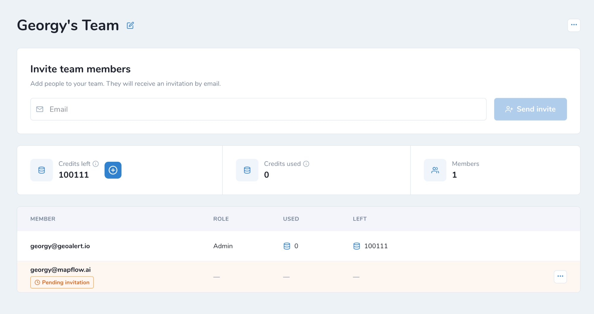
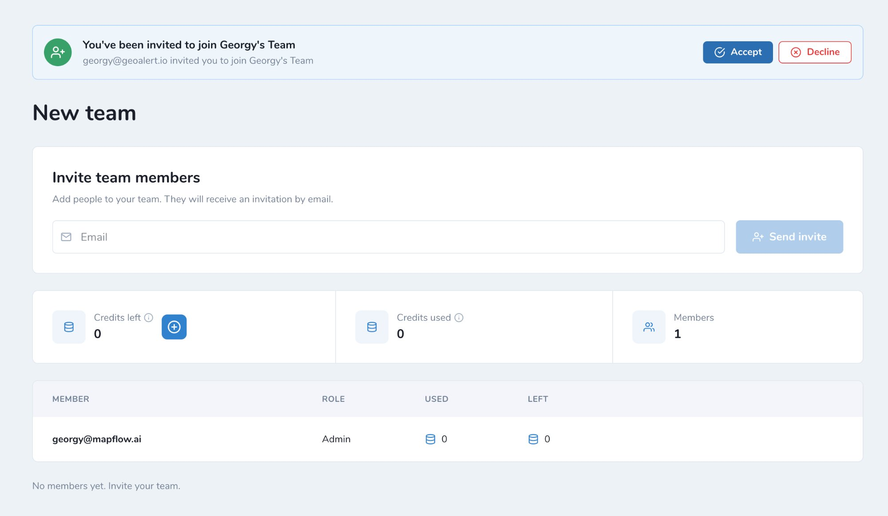
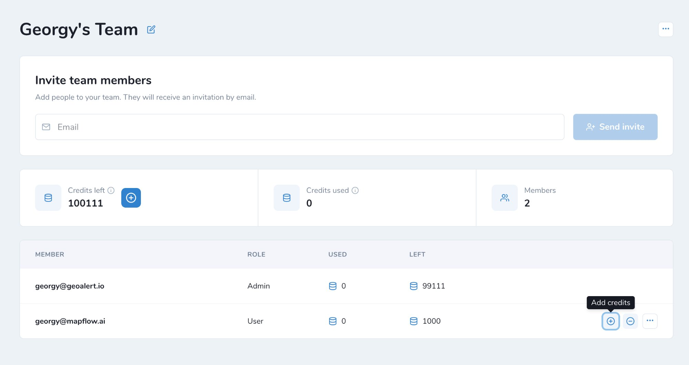
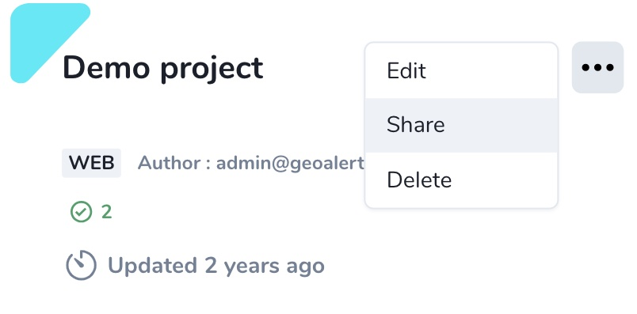
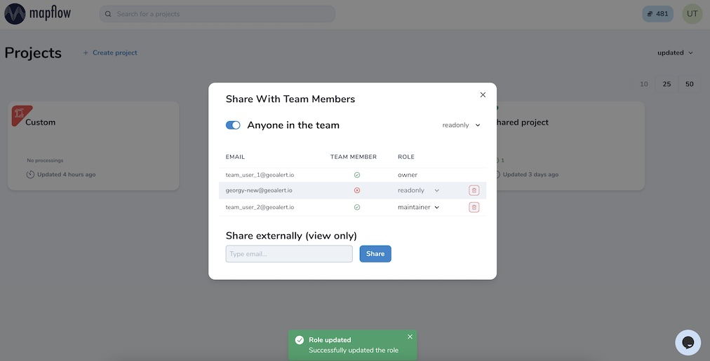

.. _Team accounts:

Team accounts
==============

A Team lets you work together with your coworkers: invite them, share projects and spend credits from one shared balance.

Open **Team** in the main menu on the left (sidebar).

.. note::
   We highly encourage you to use a Team if you work with other coworkers and manage multiple projects. Feel free to contact our support, so we can assist you in setting up a Team workflow.

How it works
-------------

There are two roles in a Team:

* **Admin** – invites users and manages the Team balance. The Admin's balance is the Team's balance.
* **User** – joins the Team by invitation and spends the Team's credits.

Invite team members
--------------------

1. Enter the user's email in **Invite team members**.
2. Click **Send invite**. The user receives the invitation by email.
3. Until the user accepts it, they are shown in the members list as **Pending invitation**.

|

.. note::
   If the user is not registered at Mapflow yet, they can join the Team after signing up.

Join a Team
------------

1. The invited user sees the invitation at the top of the **Team** page.
2. Click **Accept** to join the Team, or **Decline** to reject the invitation.

|

After joining the Team:

* You spend the Team's credits.
* Your personal balance stays untouched.
* You can't create your own Team as long as you stay in this one.

Manage Team balance
--------------------

The Admin manages the balance of the whole Team:

* **Add credits** (**+**) – move credits from the Admin's balance to a user.
* **Withdraw credits** (**-**) – take credits back from a user to the Admin's balance.

|

At the top of the page you can see:

* **Credits left** – credits remaining in the Team. Click **+** to top up the Team balance.
* **Credits used** – credits spent by the Team.
* **Members** – number of Team members.

The members list shows each member's role, credits **Used** and credits **Left**.

Both your Team balance and personal balance are displayed in the header.

.. note::
   If your Team account is switched to area-based billing, the only difference is that the balance is managed in sq. km.

Project sharing in the Team
-------------------------------

You can share your project with anyone in the Team and assign his role as needed. 
Go to the `Projects <https://app.mapflow.ai/en/projects>`_. 
Click on a dot menu icon in a project card -- Share. 

|

Select your coworkers or toggle "Anyone in the team" if you want to share with all of them.

|

There are four types of the project user's role that can be assigned to your coworkers:

* **readonly** - can view the project history and the results
* **contributor** – can run the workflows in the project
* **maintainer** – can run and edit the workflows, and share projects with users (up to maintainer role)
* **owner** – full rights to edit all roles in the project

Your collaborators will see the new shared projects in their dashboard and use them according to the role assigned.

.. note::
    You can also share your project with any users outside your team for the view-only access. 
    Go to the Project -- Share and enter the existing Mapflow user's email.
    If the new user is not registered at Mapflow.ai, invite him to register first.